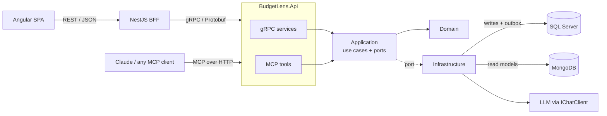

# BudgetLens 🔍

**Personal budget and investment tracker built with .NET 10, Angular and Azure — with an MCP server so any AI assistant can analyze your finances.**

> Status: 🚧 in active development. See the [roadmap](docs/roadmap.md).

## Why
Most budgeting apps track what you already spent. BudgetLens starts from the other end:
you decide **how your net income should be distributed** (fixed expenses, fun, education,
savings goals, investments) and the app shows where reality drifts from the plan —
including how your CDTs and neobank savings are actually performing.

## Features
- [ ] Budget plans by percentage, with min/target/max ranges per jar
- [ ] Presets: personal method, Six Jars, 50/30/20 — or build your own
- [ ] Expense tracking and monthly drift per jar
- [ ] Savings goals (short and long term) with required monthly contribution
- [ ] Investments: CDTs and neobank pockets — expected vs. actual return
- [ ] Debt payoff simulation: avalanche vs. snowball
- [ ] MCP server: ask Claude (or any MCP client) about your finances
- [ ] AI-generated insights on top of deterministic calculations

## Architecture
Hexagonal architecture with CQRS and polyglot persistence. The domain has no dependencies;
the gRPC services and the MCP server are two driving adapters over the same use cases. The
web client goes through a NestJS Backend-for-Frontend that speaks REST outside and gRPC inside.



Key decisions are recorded as [ADRs](docs/adr/).

## Tech stack
| Area | Choice |
|---|---|
| Backend | .NET 10, ASP.NET Core gRPC |
| Communication | REST (browser ↔ BFF) · gRPC + Protobuf, contract-first (BFF ↔ Api) · MCP (AI ↔ Api) |
| Persistence | SQL Server + EF Core (writes, source of truth) · MongoDB (read models) · Dapper · Transactional outbox |
| Frontend | Angular, Angular Material |
| BFF | NestJS (TypeScript) |
| Orchestration | Aspire (local) · Azure Container Apps (cloud) |
| AI | Model Context Protocol C# SDK · Microsoft.Extensions.AI |
| Observability | OpenTelemetry → Aspire dashboard / Application Insights |
| Quality | xUnit · Testcontainers · ArchUnitNET · GitHub Actions |

## Run locally
Requirements: .NET 10 SDK, Node.js LTS, Docker Desktop, Aspire CLI.

```bash
aspire run
```

The Aspire dashboard opens with the API, SQL Server, MongoDB, the BFF and the Angular app running together.

## Disclaimer
Insights are informational and do not constitute financial advice.
